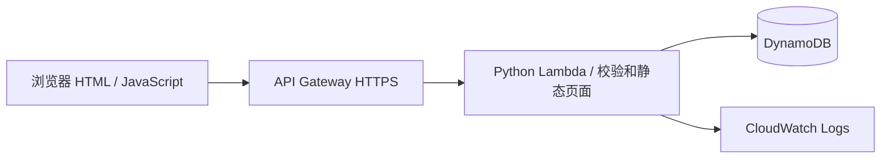

# 入社申請 / 入职申请练习

目前已完成本地演示：申请 → SQLite 登记 → 列表 → 详情。AWS DynamoDB 接口和 SAM 部署模板已编写，**尚未部署到 AWS，也尚未完成 Kiro / Copilot 的实际使用环节**。

## 立即运行

双击 `start.bat`，然后访问 http://127.0.0.1:8010 。也可以在 PowerShell 执行：

```powershell
cd C:\wang\onboarding-app
python backend/server.py
```

本地仅需 Python 3.10 或更新版本，无需 npm 或 pip 安装。当前已用 Python 3.14 验证。端口已启动时无需重复运行；如提示 8010 被占用，先打开上面的地址。

## 已实现

- 日文表单：氏名、フリガナ、生年月日、性別、メール、電話、住所、入社予定日、部署、職種、雇用形態、備考。
- 除性别、备注外均必填；前后端检查必填、邮箱、电话、日期。日期以日本时间判断；入社日期必须为今天或以后，出生日期必须早于今天。
- 申请成功生成独立申请编号、申请时间和「申請済み」状态。
- 列表展示 7 项摘要，点击姓名查看全部资料，刷新后数据仍保留。
- AWS 模式使用共享访问码保护数据接口；这是练习用保护，不具备正式员工账号和权限管理。只使用虚构数据。

## 代码怎么读

1. `backend/static/index.html`：表单输入项和三个页面区域。
2. `backend/static/app.js`：读表单 → 初步检查 → fetch POST → 显示详情；使用 textContent 显示用户输入，避免作为 HTML 执行。
3. `backend/app.py` 的 `validate`：服务端再次校验，不能仅相信浏览器。
4. `handle`：生成编号和状态，调用数据库保存，保存成功才返回 HTTP 201。
5. `SQLiteStore` / `DynamoStore`：相同方法连接不同数据库；设置 TABLE_NAME 才使用 DynamoDB。
6. `lambda_handler`：把 API Gateway HTTP API 的 v2 请求交给相同业务代码。

接口：`POST /api/applications`、`GET /api/applications`、`GET /api/applications/{id}`。列表按申请时间倒序。DynamoDB 使用完整分页扫描，适合本次少量练习数据；大量数据需要按业务访问模式设计索引及前端分页。



AWS 采用 API Gateway + Lambda + DynamoDB + CloudWatch。静态页面随 Lambda 打包并由同一域名提供，避免额外 S3 网站和跨域配置。SAM 部署时使用 S3 存放代码包。

## 验证

```powershell
python -m unittest discover -s tests -v
node --check backend/static/app.js
```

2026-09-11：11 项单元测试通过，包括数据库持久化、必填、非法格式/日期、授权、数据库失败、Lambda 请求、DynamoDB 分页 mock。另已在 Chrome 验证空表提交提示、有效申请提交、列表选择详情、刷新后数据存在。DynamoDB 测试使用 mock，不能代替 AWS 联调。

截图在 `docs/screenshots/`。已有一条明确标记为虚构的本地演示记录；数据库在 `data/applications.db`，不会纳入 Git 或源码包。

## 继续完成作业

按 [AI 开发练习步骤](docs/AI-WORKFLOW.md) 真正操作 Kiro 和 Copilot，再按 [AWS 部署步骤](docs/AWS-DEPLOY.md) 部署，最后更新 [18:00 日文汇报](docs/REPORT-JA.md)。这些步骤完成前，不应报告已完成 AWS 或已使用 Kiro/Copilot。

本项目由 `C:\wang` 根 Git 仓库统一管理，不要在子目录再 git init。只提交此目录，避免带上其他项目的修改：

```powershell
cd C:\wang
git add onboarding-app
git diff --cached --stat
git commit -m "Add onboarding application training project"
```

## 已知范围

本次不包含审批、修改、删除、员工主数据、工资或考勤。提交时按钮锁定可防连续点击，但网络中断后手动重试仍可能产生重复申请；生产环境需增加幂等键。共享访问码不替代正式身份认证。DynamoDB 表的删除策略为 Retain，删除堆栈后仍保留表，避免误删数据；练习结束需在确认不再使用后自行清理。
