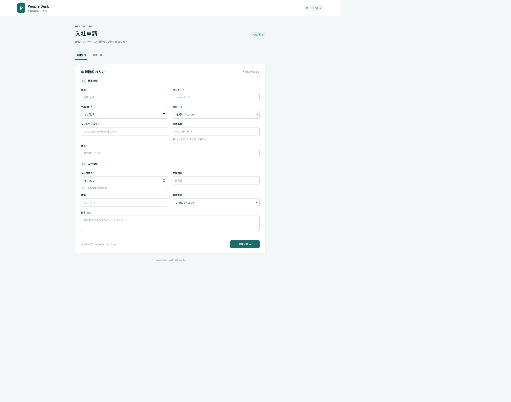
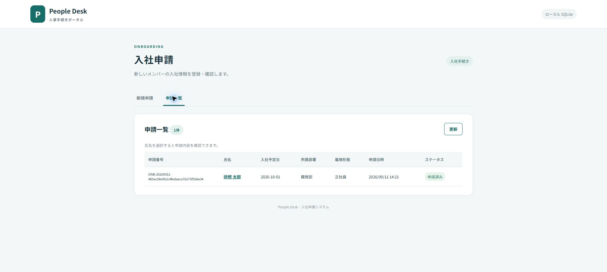
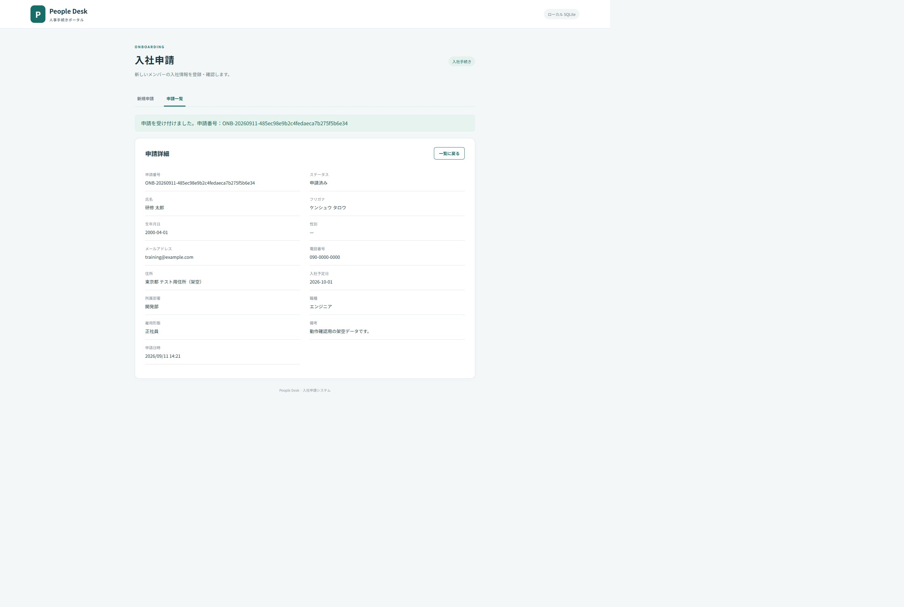

# 18:00 報告（現時点の下書き）

報告前に当日の実施結果へ更新してください。AWS・Kiro・Copilot は未実施として記載しています。

1. **使用した技術**：HTML / CSS / JavaScript、Python 3.14、SQLite、unittest。AWS 向けには boto3 と SAM テンプレートを準備しました。
2. **AWS構成**：API Gateway → Python Lambda → DynamoDB、ログは CloudWatch。構成とコードは準備済みですが、AWS へのデプロイ・実機検証は未実施です。
3. **Kiroで実施した内容**：未実施。次に、初期実装を基に要件整理・設計・タスク分解を行います。
4. **Copilotで実施した内容**：未実施。次に、入力検証のリファクタリング、境界値テスト生成、エラー調査を行います。現時点の初期コードとテストは別のAIアシスタントにより作成されました。
5. **完成した機能**：ローカル環境での入社申請画面、必須・メール・電話・日付チェック、DB登録、申請一覧、申請詳細。11件の単体テストが成功し、Chrome で一連の操作と再読み込み後のデータ保持を確認しました。
6. **未完成の機能・作業**：AWS上のDBへの登録・一覧・詳細の実機確認、Kiro/Copilot の利用実績記録、AWS画面キャプチャ。承認・変更・削除などは今回の対象外です。
7. **発生した問題**：本機の AWS CLI にアカウント・リージョン設定がなく、SAM CLI も未導入です。テストでは Windows で SQLite 接続が閉じられずファイルがロックされる問題が発生し、接続の明示的な close により解決しました。
8. **明日対応する内容**：未完了の場合、AWS認証・SAM導入、デプロイと DynamoDB の実データ確認、Kiro/Copilot の作業記録、同じフローの再テストを行います。
9. **画面キャプチャ**：`screenshots/01-form.png`、`02-list.png`、`03-detail.png`。すべてローカル SQLite 版で、架空データを使用しています。
10. **Gitのソースコードまたは成果物**：`C:\wang\onboarding-app`。Gitコミット・リモートへのプッシュは未実施です。

## 画面

### 入社申請

### 申請一覧

### 申請詳細

